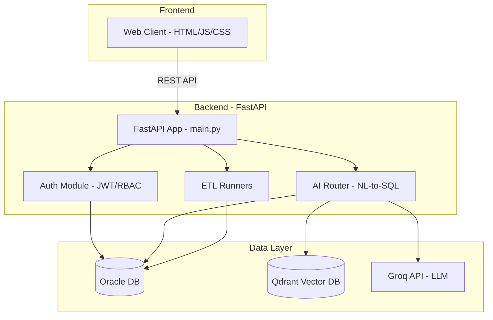
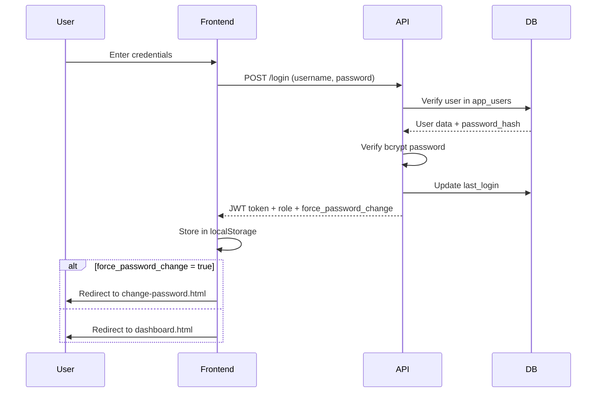
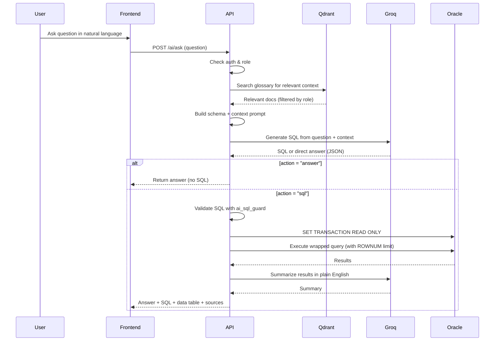
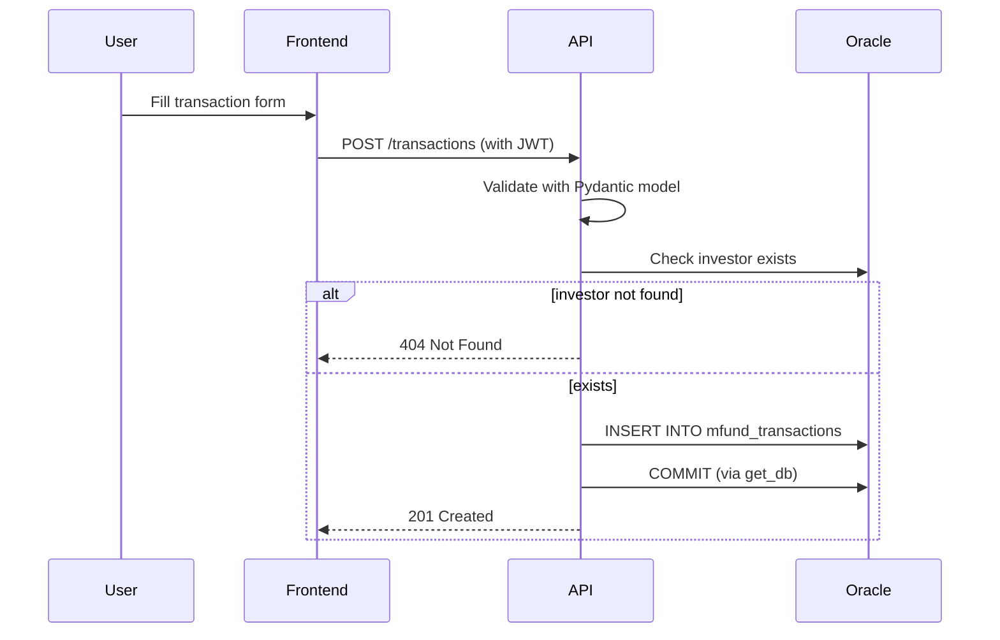
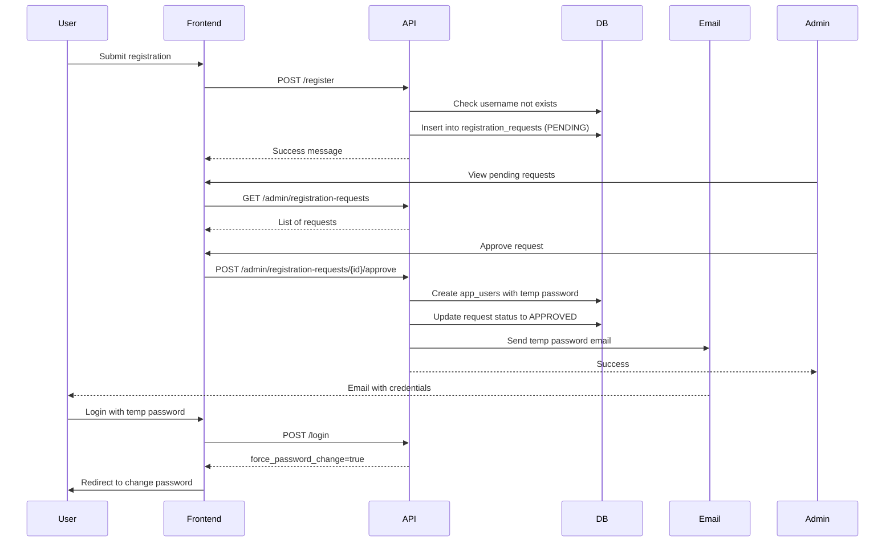

# NavDhan Mutual Fund API - Comprehensive Analysis Report

## Table of Contents
1. [Project Overview](#project-overview)
2. [Architecture](#architecture)
3. [Frontend Analysis](#frontend-analysis)
4. [Backend Analysis](#backend-analysis)
5. [Database Schema](#database-schema)
6. [NavDhan AI System](#navdhan-ai-system)
7. [Authentication & Authorization](#authentication--authorization)
8. [Dependencies](#dependencies)
9. [Execution Plan](#execution-plan)
10. [Git Ready Setup](#git-ready-setup)
11. [Flow Diagrams](#flow-diagrams)
12. [Recommendations](#recommendations)

## Project Overview

This is a **NavDhan Mutual Fund Management System** - a full-stack application for managing mutual fund investors, transactions, and AI-powered data querying. It consists of:

- **Backend API**: FastAPI (Python) with Oracle Database
- **Frontend Web Client**: Vanilla HTML/CSS/JavaScript (dual copies in `web_client/` and `api_web_client-main/`)
- **AI Layer**: Natural Language to SQL using Groq LLM + Qdrant vector DB
- **ETL Pipelines**: Data ingestion from various sources including S3

## Architecture



### Project Structure

```
fast_api_with_ai/
├── api_web_client-main/     # Frontend copy (static HTML/JS)
└── fast_api_project/
    ├── client_api/          # Python CLI/API client utilities
    ├── server_api/          # FastAPI backend
    ├── tests/               # Test suite
    ├── web_client/          # Frontend copy (integrated)
    ├── .env.ai.example      # AI config template
    ├── README_AI.md         # AI documentation
    └── requirements.txt     # Dependencies
```

## Frontend Analysis

**Technology**: Vanilla HTML5, CSS3, JavaScript (ES6+)

### Pages
| Page | Purpose | Access |
|------|---------|--------|
| `login.html` | User authentication | Public |
| `register.html` | Self-registration request | Public |
| `forgot-password.html` | Password reset request | Public |
| `reset-password.html` | Set new password via token | Public |
| `change-password.html` | Change password (authenticated) | Authenticated |
| `dashboard.html` | Main dashboard with investor/transaction overview | Authenticated |
| `transactions.html` | Transaction management | Authenticated |
| `ai.html` | **NavDhan AI** - NL-to-SQL interface (Ask, Chat, Insights) | Authenticated (Insights: Admin/Manager) |
| `admin-requests.html` | Registration request approval/rejection | Admin only |
| `admin-users.html` | User management (roles, activation, deletion) | Admin only |

### Key Frontend Features
- **JWT token management** via `localStorage`
- **Role-based UI rendering** (hide/show admin/manager features)
- **Force password change flow**
- **Floating AI chat button** on all pages (persistent conversation)
- **Responsive design** with CSS
- **API calls** centralized in `app.js` and `config.js`

## Backend Analysis

**Framework**: FastAPI 0.111+ with Uvicorn  
**Database**: Oracle Database (via `oracledb`)  
**Auth**: JWT (python-jose) + bcrypt (passlib)

### Core Modules

| Module | Purpose |
|--------|---------|
| `main.py` | App entry point, routes, exception handlers, lifespan management |
| `config.py` | Environment config, validation, fail-fast checks |
| `database.py` | Connection pooling, context managers |
| `models.py` | Pydantic schemas with validation |
| `auth.py` | JWT, password hashing, RBAC decorators |
| `exceptions.py` | Custom exception classes |

### API Endpoints

#### Authentication & User Management
| Method | Endpoint | Auth | Description |
|--------|----------|------|-------------|
| POST | `/login` | Public | OAuth2 form login, returns JWT |
| POST | `/register` | Public | Submit registration request |
| POST | `/change-password` | Auth | Change own password |
| POST | `/forgot-password` | Public | Request password reset |
| POST | `/reset-password` | Public | Reset password with token |
| GET | `/admin/registration-requests` | Admin | List registration requests |
| POST | `/admin/registration-requests/{id}/approve` | Admin | Approve request, email temp password |
| POST | `/admin/registration-requests/{id}/reject` | Admin | Reject request |
| GET | `/admin/users` | Admin | List all users |
| PATCH | `/admin/users/{username}` | Admin | Update user role/status |
| DELETE | `/admin/users/{username}` | Admin | Delete user |

#### Investor & Transaction Management
| Method | Endpoint | Auth | Description |
|--------|----------|------|-------------|
| POST | `/investors` | Auth | Create investor |
| GET | `/investors` | Auth | List all investors |
| GET | `/investors/{id}` | Auth | Get investor details |
| PUT | `/investors/{id}` | Auth | Full update investor |
| PATCH | `/investors/{id}` | Auth | Partial update investor |
| DELETE | `/investors/{id}` | Admin | Delete investor |
| POST | `/transactions` | Auth | Create transaction |
| GET | `/transactions/investor/{id}` | Auth | Get transactions for investor |
| GET | `/investors/{id}/transactions` | Auth | Get investor with transactions |

#### ETL & Pipelines
| Method | Endpoint | Auth | Description |
|--------|----------|------|-------------|
| POST | `/run-etl` | Admin | Run standard ETL pipeline (background) |
| POST | `/run-horse-etl` | Admin | Run horse data pipeline from S3 (background) |
| GET | `/run-etl/{job_id}` | Admin | Check ETL job status |

#### NavDhan AI
| Method | Endpoint | Auth | Description |
|--------|----------|------|-------------|
| GET | `/ai/status` | Auth | AI config status, Qdrant status |
| POST | `/ai/ask` | Auth | One-shot NL question -> SQL -> answer |
| POST | `/ai/chat` | Auth | Multi-turn conversational AI |
| GET | `/ai/insights` | Admin/Manager | Auto-generated business insights |
| POST | `/ai/reindex` | Admin | Re-index glossary to Qdrant |

## Database Schema

### Core Tables (Business Data)
```sql
-- Investors master
investor_table (
  investor_id VARCHAR2 PRIMARY KEY,
  name VARCHAR2,
  email VARCHAR2,
  mobile VARCHAR2,
  kyc_status VARCHAR2 CHECK ('Verified','Pending','Rejected'),
  pan VARCHAR2
)

-- Mutual fund transactions
mfund_transactions (
  transaction_id NUMBER (generated),
  folio_id VARCHAR2,
  investor_id VARCHAR2 FK -> investor_table,
  scheme_id VARCHAR2,
  units NUMBER,
  nav NUMBER,
  amount NUMBER,
  txn_type VARCHAR2 CHECK ('PURCHASE','SIP','REDEMPTION'),
  txn_date DATE
)
```

### Auth Tables
```sql
-- Users
app_users (
  user_id NUMBER IDENTITY PRIMARY KEY,
  username VARCHAR2 UNIQUE NOT NULL,
  password_hash VARCHAR2 NOT NULL,
  email VARCHAR2,
  role VARCHAR2 CHECK ('admin','manager','user'),
  is_active NUMBER(1),
  force_password_change NUMBER(1),
  created_at DATE,
  last_login DATE
)

-- Registration requests
registration_requests (
  request_id NUMBER IDENTITY PRIMARY KEY,
  username VARCHAR2,
  full_name VARCHAR2,
  email VARCHAR2,
  mobile VARCHAR2,
  requested_role VARCHAR2,
  reason VARCHAR2,
  status VARCHAR2 CHECK ('PENDING','APPROVED','REJECTED'),
  requested_at DATE,
  reviewed_at DATE,
  reviewed_by VARCHAR2
)

-- Password reset tokens
password_reset_tokens (
  token VARCHAR2 PRIMARY KEY,
  username VARCHAR2 FK -> app_users,
  expires_at DATE,
  used NUMBER(1),
  created_at DATE
)

-- ETL job tracking
etl_jobs (
  job_id VARCHAR2 PRIMARY KEY,
  triggered_by VARCHAR2,
  status VARCHAR2,
  output CLOB,
  error_message CLOB,
  started_at DATE,
  finished_at DATE
)
```

## NavDhan AI System

This is a sophisticated NL-to-SQL system with multiple safety layers.

### Architecture Flow
```
Question -> Qdrant Search (Glossary) -> Schema + Context -> Groq LLM -> SQL
         -> SQL Guard (Validation) -> Oracle (Read-Only) -> Summary -> Answer
```

### AI Modules

| Module | Purpose |
|--------|---------|
| `ai_router.py` | API endpoints for AI features |
| `ai_service.py` | Core logic - ask, converse, insights |
| `ai_llm.py` | Groq API client (OpenAI-compatible) |
| `ai_qdrant.py` | Vector DB for glossary retrieval |
| `ai_sql_guard.py` | SQL security validation |
| `navdhan_glossary.yaml` | Business glossary (definitions, rules, examples) |
| `ingest_glossary.py` | Script to index glossary into Qdrant |

### Safety Features
- **SQL Guard**: Only SELECT, allowlisted tables, no DML/DDL/PL-SQL, blocks comments, prevents DB links
- **Role-based column filtering**: PAN/mobile/email hidden from non-admin users
- **Read-only transactions**: `SET TRANSACTION READ ONLY`
- **Query timeout**: `call_timeout` on Oracle connection
- **Row limit**: Max 200 rows returned (configurable)
- **No data leakage**: Qdrant stores only metadata, not row data
- **Audit logging**: All AI queries logged with username, question, SQL
- **Self-correction**: LLM retries once on SQL errors
- **Instruction injection protection**: Treats user/query data as data, not instructions

### AI Features
1. **Ask** (`/ai/ask`) - One-shot question answering
2. **Chat** (`/ai/chat`) - Multi-turn conversation with context
3. **Insights** (`/ai/insights`) - Pre-computed KPIs with LLM narrative (cached 10 min)
4. **Status** - Check configuration and Qdrant health
5. **Reindex** - Update glossary embeddings

### Glossary Structure
The `navdhan_glossary.yaml` contains:
- Global SQL rules
- Table/view definitions with business context
- Business metrics (inflow, outflow, net investment, SIP amounts)
- Relationships between tables
- Business rules (inflow/outflow logic, date handling)
- Question patterns
- SQL generation examples (10+ examples)
- Business language mappings

## Dependencies

### Core
```txt
fastapi>=0.111.0
uvicorn[standard]>=0.30.0
oracledb>=2.0.0
python-dotenv>=1.0.0
pydantic[email]>=2.0.0
```

### Auth & Security
```txt
python-jose[cryptography]>=3.3.0
passlib[bcrypt]>=1.7.4
python-multipart>=0.0.9
```

### Data Processing
```txt
pandas>=2.0.0
numpy>=1.24.0
openpyxl>=3.1.0
boto3>=1.34.0
```

### AI Stack
```txt
sqlglot>=25.0.0
qdrant-client>=1.9.0
fastembed>=0.3.0
pyyaml>=6.0
```

## Execution Plan

### Prerequisites
- Python 3.9+
- Oracle Database access (or compatible)
- Groq API key (for AI features)
- Qdrant instance (or use `:memory:` for dev)
- Docker (optional, for Qdrant)

### Setup Steps

#### 1. Environment Setup
```bash
# Clone/navigate to project
cd C:\Users\DELL\Desktop\fast_api_with_ai\fast_api_project

# Create virtual environment
python -m venv venv
venv\Scripts\activate  # Windows
# source venv/bin/activate  # Linux/Mac

# Install dependencies
pip install -r requirements.txt
```

#### 2. Database Setup
```sql
-- Connect as Oracle user
-- Run schema creation
@server_api/create_login_table.sql

-- Create initial admin user
cd server_api
python create_user.py
```

#### 3. Environment Configuration
Create `.env` file in `server_api/` directory:

```env
# Database
DB_USER=your_oracle_user
DB_PASSWORD=your_oracle_password
DB_HOST=your_host
DB_PORT=1521
DB_SERVICE=your_service_name
DB_POOL_MIN=1
DB_POOL_MAX=10
DB_POOL_INCREMENT=1

# JWT
JWT_SECRET_KEY=generate_a_long_random_secret_key_here
JWT_ALGORITHM=HS256
JWT_EXPIRE_MINUTES=60

# CORS
CORS_ORIGINS=*

# Email (optional for local dev - will log if not configured)
SMTP_HOST=smtp.gmail.com
SMTP_PORT=587
SMTP_USER=your_email@gmail.com
SMTP_PASSWORD=your_app_password
SMTP_FROM_EMAIL=your_email@gmail.com
SMTP_USE_TLS=true

# Frontend
FRONTEND_BASE_URL=http://127.0.0.1:5500

# AI - Groq
GROQ_API_KEY=your_groq_api_key
GROQ_MODEL=openai/gpt-oss-120b
AI_LLM_TIMEOUT_SECONDS=45

# AI - Tables
AI_ALLOWED_TABLES=investor_table,mfund_transactions
AI_SENSITIVE_COLUMNS=pan,mobile,email
AI_MAX_ROWS=200
AI_QUERY_TIMEOUT_MS=15000

# AI - Qdrant
AI_USE_QDRANT=true
QDRANT_URL=http://localhost:6333
# QDRANT_API_KEY=  # if using cloud
QDRANT_COLLECTION=navdhan_fastapi_schema
AI_EMBED_MODEL=sentence-transformers/all-MiniLM-L6-v2
AI_RETRIEVAL_LIMIT=6

# AWS S3 (optional for horse ETL)
# AWS_ACCESS_KEY_ID=
# AWS_SECRET_ACCESS_KEY=
# AWS_REGION=ap-south-1
# S3_BUCKET_NAME=
# S3_HORSE_DATA_KEY=
```

#### 4. Start Qdrant (for AI features)
```bash
# Using Docker
docker run -p 6333:6333 qdrant/qdrant

# Or use in-memory (no persistence): set QDRANT_URL=:memory: in .env
```

#### 5. Index AI Glossary
```bash
cd server_api
python ingest_glossary.py
```

#### 6. Run Backend
```bash
cd server_api
uvicorn main:app --reload --host 127.0.0.1 --port 8000
```

API will be available at: `http://127.0.0.1:8000`  
Swagger docs at: `http://127.0.0.1:8000/docs`

#### 7. Run Frontend
```bash
# Using Python HTTP server
cd web_client  # or api_web_client-main
python -m http.server 5500

# Or use Live Server in VS Code
```
Frontend at: `http://127.0.0.1:5500`

#### 8. Run Tests
```bash
cd fast_api_project
pip install pytest httpx
python -m pytest tests -q
```

## Git Ready Setup

### Initialize Git Repository
```bash
cd C:\Users\DELL\Desktop\fast_api_with_ai
git init
```

### Create .gitignore
```gitignore
# Python
__pycache__/
*.py[cod]
*$py.class
*.so
.Python
venv/
env/
ENV/

# Environment
.env
.env.local
*.env

# IDE
.vscode/
.idea/
*.swp
*.swo

# OS
.DS_Store
Thumbs.db

# Logs
*.log

# Testing
.pytest_cache/
.coverage
htmlcov/

# Qdrant local data
qdrant_storage/

# Oracle instant client
instantclient_*

# Temp files
*.tmp
```

### Add and Commit
```bash
git add .
git commit -m "Initial commit: NavDhan Mutual Fund API with AI features"
```

### Create Branches (recommended)
```bash
git branch -M main
git checkout -b develop
```

## Flow Diagrams

### Authentication Flow


### NL-to-SQL AI Flow


### Transaction Creation Flow


### Registration & Approval Flow


## Recommendations

### Security
- [ ] Change default SMTP credentials in config.py (currently hardcoded)
- [ ] Use strong JWT_SECRET_KEY in production
- [ ] Restrict CORS_ORIGINS to specific domains in production
- [ ] Enable HTTPS in production
- [ ] Rotate API keys regularly
- [ ] Add rate limiting to login/AI endpoints
- [ ] Consider using secrets manager instead of .env

### Performance
- [ ] Add Redis for caching (insights already cached in memory)
- [ ] Optimize database queries with indexes
- [ ] Add connection pool tuning based on load
- [ ] Consider pagination for large result sets

### Features
- [ ] Add export functionality (CSV/PDF) for reports
- [ ] Implement audit logging for admin actions
- [ ] Add 2FA for admin accounts
- [ ] Expand AI to support more tables
- [ ] Add data visualization charts in frontend

### Code Quality
- [ ] Add type hints throughout
- [ ] Increase test coverage
- [ ] Add API versioning
- [ ] Implement structured logging
- [ ] Add health check for dependencies (Qdrant, Oracle, Groq)

## Quick Start Commands

```bash
# Backend
cd fast_api_project/server_api
pip install -r ../requirements.txt
uvicorn main:app --reload

# Frontend
cd fast_api_project/web_client
python -m http.server 5500

# Qdrant
docker run -p 6333:6333 qdrant/qdrant

# AI Index
cd fast_api_project/server_api
python ingest_glossary.py

# Tests
cd fast_api_project
python -m pytest tests -q
```

---

**Generated on**: October 28, 2026  
**Project**: NavDhan Mutual Fund API with AI  
**Status**: Production-ready with comprehensive features
