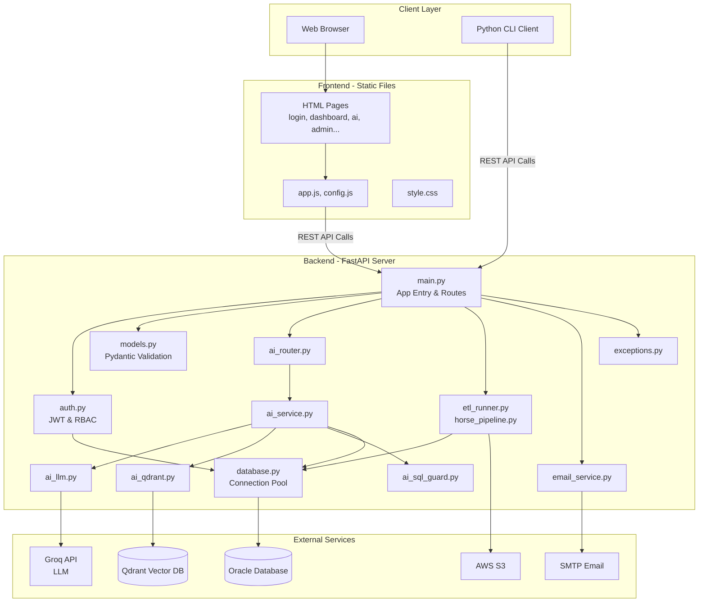
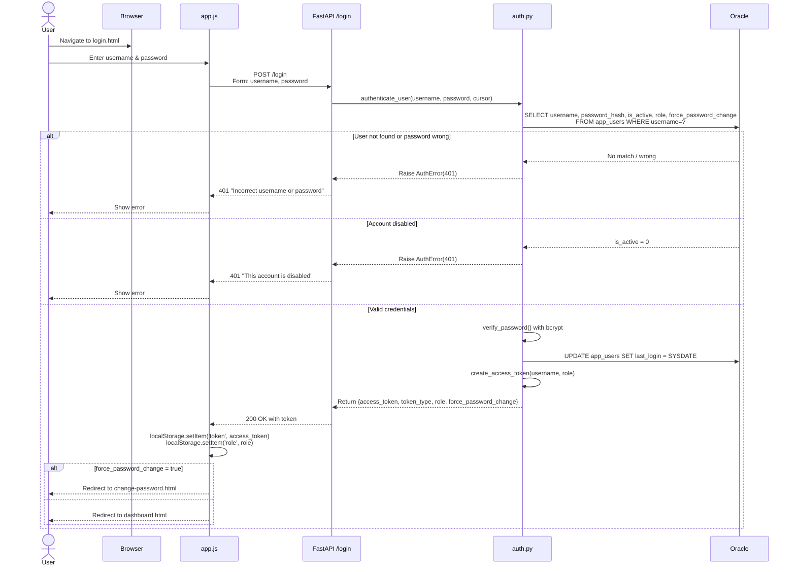
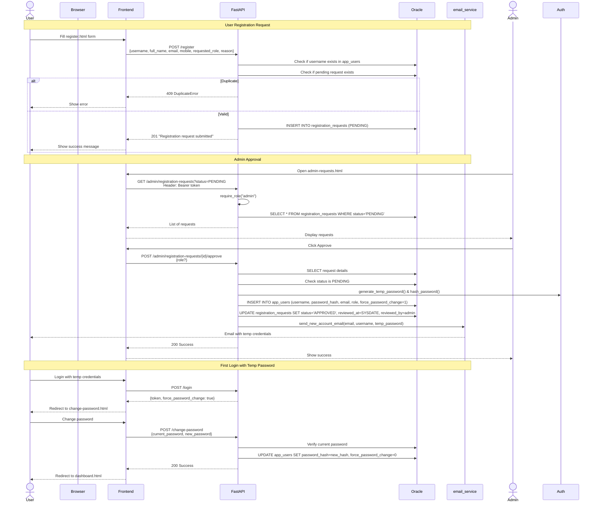
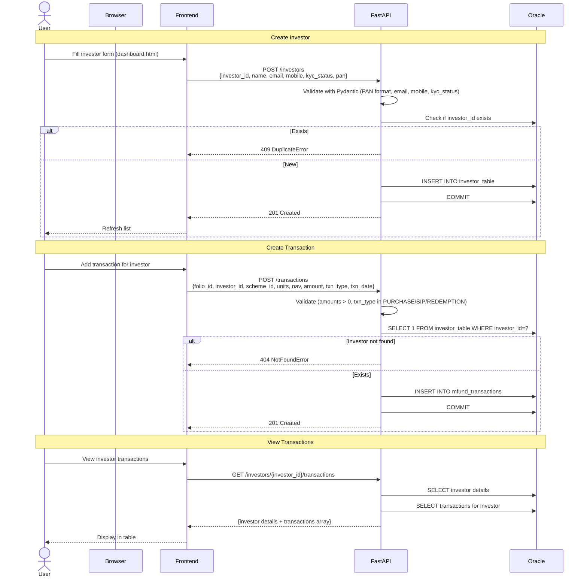
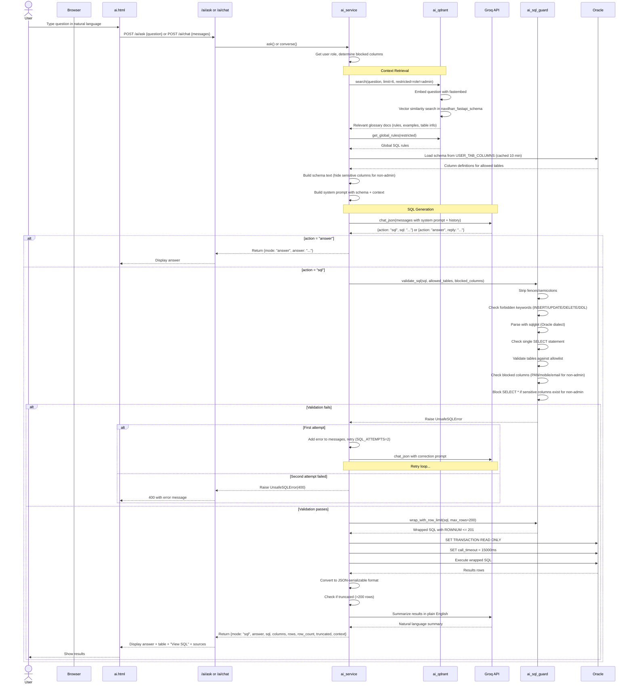
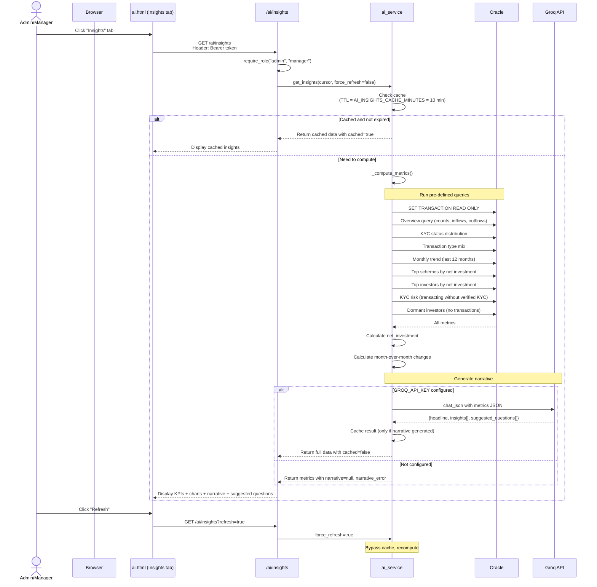
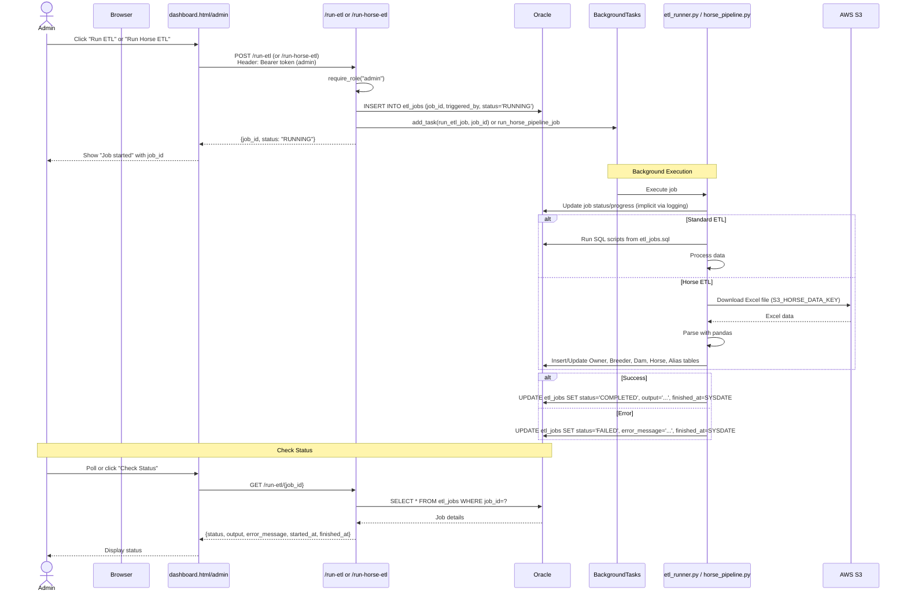
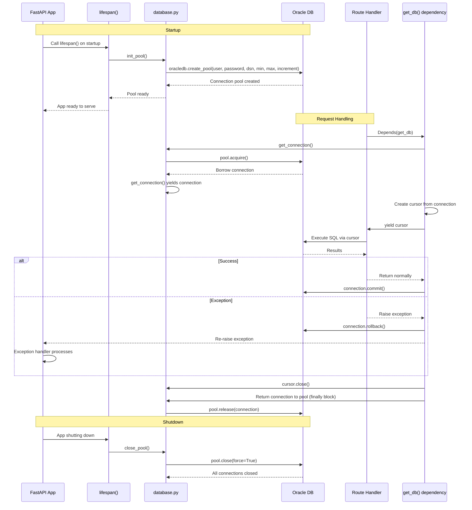

# Flow Diagrams - NavDhan Mutual Fund API

## System Architecture Overview



## 1. User Authentication Flow



## 2. Registration & Admin Approval Flow



## 3. Investor & Transaction Management Flow



## 4. NavDhan AI - Natural Language to SQL Flow



## 5. AI Insights Flow



## 6. ETL Pipeline Flow



## 7. Database Connection Pool Flow



## 8. Error Handling Flow

```mermaid
graph TD
    Request[Incoming Request] --> Route[Route Handler]
    Route --> Try{Try to Execute}
    
    Try -->|Validation Error| VE[RequestValidationError<br/>Pydantic]
    Try -->|App Error| AE[AppError subclasses<br/>NotFound, Duplicate, etc.]
    Try -->|Integrity Error| IE[oracledb.IntegrityError]
    Try -->|DB Error| DE[oracledb.DatabaseError]
    Try -->|Other Error| OE[Generic Exception]
    Try -->|Success| Success[Return Response]
    
    VE --> VEH[validation_error_handler<br/>422]
    AE --> AEH[app_error_handler<br/>Custom status code]
    IE --> IEH[integrity_error_handler<br/>409]
    DE --> DEH{Check error code}
    DEH -->|Connection error codes<br/>12154,12541,3113,3114,1034,12170| CE[503 DatabaseUnavailableError]
    DEH -->|Other DB error| DBE[500 DatabaseError<br/>Generic message]
    OE --> OEH[unhandled_exception_handler<br/>500 InternalServerError<br/>Log full traceback]
    
    VEH --> Resp[JSON Response<br/>{error: {message, type}}]
    AEH --> Resp
    IEH --> Resp
    CE --> Resp
    DBE --> Resp
    OEH --> Resp
```

## Component Interaction Summary

| Component | Interacts With | Purpose |
|-----------|----------------|---------|
| **Frontend (HTML/JS)** | FastAPI REST API | User interface, token management |
| **main.py** | All modules, FastAPI framework | App orchestration, routing, middleware, error handling |
| **auth.py** | database.py, config.py, exceptions.py | Authentication, authorization, token management |
| **database.py** | Oracle DB via oracledb | Connection pooling, transaction management |
| **ai_service.py** | ai_llm, ai_qdrant, ai_sql_guard, database | AI orchestration and business logic |
| **ai_llm.py** | Groq API (HTTP) | LLM communication |
| **ai_qdrant.py** | Qdrant DB (HTTP/gRPC) | Vector search and glossary storage |
| **ai_sql_guard.py** | sqlglot | SQL validation and security |
| **etl_runner.py** | database.py, pandas | Data processing pipelines |
| **horse_pipeline.py** | S3 (boto3), database.py, pandas, openpyxl | Horse data ingestion from S3 |
| **email_service.py** | SMTP server | Email notifications |

---

**Note**: These diagrams use Mermaid syntax and can be rendered in GitHub, GitLab, or most Markdown viewers that support Mermaid.
